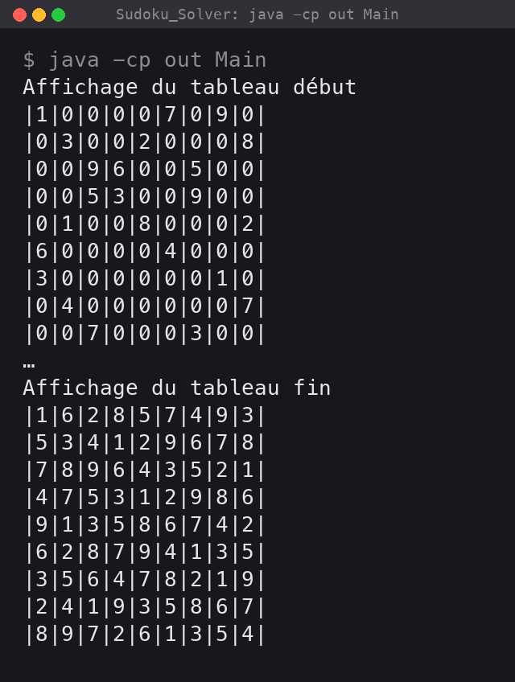

# Sudoku Solver

[](https://github.com/LaCobble/Sudoku_Solver/actions/workflows/ci.yml)
[](LICENSE)


A Java program that solves a 9 x 9 Sudoku grid with a **backtracking** algorithm and prints the result in the console.

## What it does

`Main` loads a sample grid (`0` = empty cell), prints it, runs a few checks of the helper methods, solves the grid and prints the solution.

<p align="center">

</p>

*Real console output of `java -cp out Main`, blank lines and the helper checks (…) left out. "Affichage du tableau début / fin" means "initial / final grid".*

<details>
<summary>Same output as text</summary>

```text
Affichage du tableau début
|1|0|0|0|0|7|0|9|0|
|0|3|0|0|2|0|0|0|8|
|0|0|9|6|0|0|5|0|0|
|0|0|5|3|0|0|9|0|0|
|0|1|0|0|8|0|0|0|2|
|6|0|0|0|0|4|0|0|0|
|3|0|0|0|0|0|0|1|0|
|0|4|0|0|0|0|0|0|7|
|0|0|7|0|0|0|3|0|0|
…
Affichage du tableau fin
|1|6|2|8|5|7|4|9|3|
|5|3|4|1|2|9|6|7|8|
|7|8|9|6|4|3|5|2|1|
|4|7|5|3|1|2|9|8|6|
|9|1|3|5|8|6|7|4|2|
|6|2|8|7|9|4|1|3|5|
|3|5|6|4|7|8|2|1|9|
|2|4|1|9|3|5|8|6|7|
|8|9|7|2|6|1|3|5|4|
```

</details>

To solve another grid, edit the values in `Sudoku.setTab()`.

## Requirements

- A JDK (tested with JDK 17).

## Build and run

```bash
git clone https://github.com/LaCobble/Sudoku_Solver.git
cd Sudoku_Solver
javac -encoding UTF-8 -d out *.java
java -cp out Main
```

## Project structure

```
├── Main.java    # Demo: prints the grid, tests the helpers, solves and prints the solution
└── Sudoku.java  # The grid and the solver
```

Main methods of `Sudoku`:

| Method | Role |
| --- | --- |
| `tableauVide()` | Initialises an empty grid. |
| `setTab()` | Sets the grid to solve (edit it to try another puzzle). |
| `affichTableau()` | Prints the grid. |
| `estPossible(...)` | Checks whether a value can be placed in a cell without breaking the row, column and 3 x 3 box rules. |
| `caseSuivante(...)` | Returns the coordinates of the next cell (row by row). |
| `solve(row, col)` | Recursive backtracking solver. |

## What it demonstrates

- **Backtracking**: try a value in an empty cell, recurse to fill the rest of the grid, undo the choice when a dead end is reached.
- Constraint checking on rows, columns and 3 x 3 boxes.
- Recursive problem solving on a 2D array.

The solver targets standard puzzles; very hard grids can take much longer, since there is no heuristic to choose the next cell.

## Context

Second-year Computer Science assignment at university (2022). Method names and messages are in French.

## Contributing

This is an archived learning project, but issues and pull requests are welcome: see [CONTRIBUTING.md](CONTRIBUTING.md) and the [Code of Conduct](CODE_OF_CONDUCT.md).

## License

[MIT](LICENSE) © LaCobble
